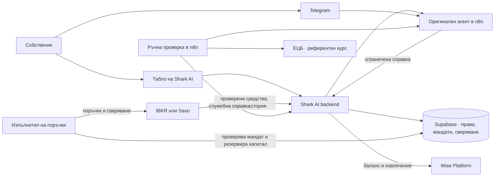

# Shark AI · Портфейл, инвестиции и проверка на модулите

## Какво вижда собственикът

В таблото собственикът избира валута, максимална сума от отделената печалба, стратегия и период — ден, определен брой дни, седмица или месец. Периодът може да се разгледа и без цел. Прогнозата за търговия използва свободната, реализирана и уредена нетна печалба в отделената брокерска сметка, до разрешения от собственика таван. При депозит без потвърдена печалба сумата за поръчки е нула. Ако има достатъчно проверена история, сайтът показва обичайния нетен диапазон (5-и и 95-и персентил), медианата, най-слабия и най-силния исторически период. Изчислението включва загубите и таксите. Бъдещият резултат може да излезе извън наблюдаваните граници. [Инвестиционен риск](https://www.investor.gov/introduction-investing/investing-basics/what-risk)

Аналитичният достъп и разрешението за автоматични поръчки се управляват отделно. Собственикът преглежда точния капитал, брокерската сметка, активите, периода, допустимата загуба на печалба и срока, преди да потвърди мандата. Достигната цел спира новите поръчки за остатъка от периода. Системата не увеличава позицията за наваксване при текущ минус. Отворените позиции и поръчки продължават да се сверяват. [Условия на мандата](trading-consent.md)

### Справка по въведена сума

Въведи сума, валута и срок от един ден, една до четири седмици или един календарен месец. Месецът започва от днешната дата по UTC и завършва на същото число през следващия месец. При по-къс месец се използва последният му ден. Например месецът от 31 януари 2028 г. завършва на 29 февруари.

Справката сравнява въведената сума с най-ниската и най-високата наблюдавана доходност за поне 60 пълни, последователни, неприпокриващи се периода от проверена брокерска история за същата стратегия. За календарния месец се използва същото начално число и в миналото. Процентите и сумите отчитат загубите и потвърдените брокерски разходи преди евентуалното възнаграждение на Shark AI. Историческите граници могат да бъдат надхвърлени и в двете посоки. Липсваща история или неподходящ за сумата диапазон на разходите се отбелязва като недостъпен резултат.

Отделната сума по активен мандат използва само потвърден свободен търговски капитал от уредена печалба. Защитеният депозит и въведената в справката стойност не се превеждат или резервират при изчисляването. При спрян изпълнител, липсващ мандат или непотвърдени средства разполагаемата сума е нула.

## Връзки между системите

| Възли | Предназначение |
|---|---|
| W01, W02, W04 | Уеб, имейл и личен Telegram чат към общия агент. W03 е отложен по решение на собственика. |
| W10–W14, W19 | Агент, инструменти, одобрение, чернови, контекст и обработка на грешки. |
| W20, W21 | Референтен курс на ЕЦБ и прогноза от проверена брокерска история. Референтният курс служи за справка. Брокерската поръчка изисква собствена актуална котировка. |
| W23–W25, W29 | Проверки преди поръчка, сверяване, седмичен нетен резултат и аварийно спиране. Подаването към реалния брокер е зад отделния сървърен изпълнител. |
| W30–W33, W39 | Свързване на портфейла, баланс, постъпления, преминаване към Wise за действие на собственика и Stripe събития за абонаменти. |

В локалната конфигурация на сайта Pro е 12 EUR, а Ultra е 28 EUR. Действащите Stripe Product/Price ID и цените в бизнес акаунта изискват проверка чрез оторизиран достъп. Предложените в заданието 250 и 4 999,99 EUR се отнасят до капитал. Реалните лимити идват от потвърдените правила на съответния план и сметка. [Конфигурация на сайта](../lib/agents.ts) · [Доставчици и договорен статус](provider-matrix.md)

## Личен портфейл и прогноза

Бутонът „Създай портфейл“ отваря самостоятелната страница `/wallet`. Балансът и движенията се четат от потвърдената сметка на влезлия собственик. Движенията обхващат последните 30 дни и показват до 100 от най-новите записи. Достъпът до извлечение изисква разрешение при Wise. Отварянето на страницата само по себе си не създава сметка при финансов доставчик.

Въведената сума и периодът дават справка за най-ниския и най-високия наблюдаван резултат на свързаната стратегия, както в проценти, така и в избраната валута. Могат да се изберат 1 ден, 1, 2, 3 или 4 седмици или един календарен месец. Сумата остава отделена от разрешения за сделки капитал. Екранът посочва периода на историята, размера на извадката и източника. Процентите отчитат брокерските разходи. Платформената такса се определя при действително приключване на периода.

За евро има отделна публична справка за паричния пазар. Тя използва до 520 публикувани стойности на натрупания индекс €STR на ЕЦБ. Изчисляват се доходностите между дати с наблюдение и в двата края на избрания срок. Периодите може да се застъпват. Данните за пазарния индекс не са личен баланс или прогнозирана доходност на агента. [Методика на ЕЦБ](https://www.ecb.europa.eu/stats/financial_markets_and_interest_rates/euro_short-term_rate/html/eurostr_overview.en.html) · [Източник на индекса](https://data-api.ecb.europa.eu/service/data/EST/B.EU000A2QQF08.CI?format=csvdata&lastNObservations=520)

## Стратегии и дропшипинг

Инвестиционното табло сравнява стратегии за избрания период и валута. За най-добър кандидат се изискват предварително регистриран набор за сравнение и независимо проверени резултати. Таблото за дропшипинг показва поръчки, възстановявания и разходи по данни от магазина и доставчика. Отчетените дни са в UTC. Собственикът задава отделен търговски бюджет и избира дали агентът и неговият Telegram чат да могат да четат справката. [Метод за сравнение](strategy-product-research.md) · [Свързване на Shopify и Printful](commerce-dropshipping.md)

## Комисиона и администраторска справка

Платформата начислява **10% от новата допустима реализирана нетна печалба** в края на договорения период. При 100 EUR допустима печалба таксата е 10 EUR, а за клиента остават 90 EUR. Вноските, регистрациите и положителната преоценка на отворени позиции не създават комисиона. Извлечението отчита разходите и откритите загуби. Нова комисиона се начислява за сумата над предишното най-високо равнище, за което е отчетена допустима печалба. Възстановяване само до същото равнище носи нулева такса.

Администраторът избира дати по софийско време. Справката показва регистрираните през периода, текущия им план и първоначалния план, когато за него има запис. Вземанията се отнасят към последния ден от съответния търговски период. Постъпленията и сторниранията следват датата на потвърденото осчетоводяване от брокера. Валутите се показват отделно. При отворена страница справката се обновява на 15 секунди.

Реалното плащане се извършва по лицензирана и одобрена от клиента схема за таксуване в полза на конкретната платформена сметка. Екранът отчита получена сума след съпоставени потвърждения за клиентски дебит и кредит към този получател. IBKR посочва, че таксите на съветника постъпват в неговата договорена главна сметка. Нативната такса „процент от P&L“ използва пазарна преоценка и тримесечен или годишен период. Нужна е отделна проверка дали договорът и разрешеният метод на фактуриране покриват избраната база и честота. [Такси и фактуриране при IBKR](https://www.interactivebrokers.com/en/pricing/advisor-fees.php) · [Сметка на съветника](https://www.interactivebrokers.com/support/faq/content/collected-advisor-fees-go-102536125)

## Изпълнение на проверката

В секцията **„Проверка на модулите“** стартирай оригиналния ръчен тригър с **Execute workflow**. Отвори **„Отчет за всички модули“**. За всяка функция отчетът показва име, статус и причина. Зелен финал изисква потвърждение за всички задължителни функции. При липсваща връзка, грешен профил или остарели данни финалният червен възел изброява непреминалите проверки. Грешка в самото изпълнение на n8n може да прекъсне проверката по-рано и да се покаже върху съответния възел.

Ръчната проверка използва действителния агент, неговия инструмент, референтния курс на ЕЦБ и удостоверена служебна справка. За Telegram е нужен успешен отговор от агента, приет от Telegram за същия личен чат. За реална поръчка се проверява готовността на брокерската връзка чрез четене. За теглене се проверява маршрутът за потвърждение от самия собственик. [Експлоатация, права и връщане на версия](operations-runbook.md)

## Проверено към 19 ноември 2026 г.

| Среда | Наблюдаван резултат |
|---|---|
| Оригинален n8n | Ръчният вход, агентът и инструментът за цел се изпълниха. При 50 EUR върху 1 000 EUR за 7 дни резултатът беше 5,00%. Необходим е повторен тест с актуалния диагностичен клон и с реалния Telegram бот. |
| Оригинален Supabase | Инсталирани са настройките, записът на началния план при регистрация, защитата на депозита и отчетите за комисиони. Всички 25 таблици в частните брокерска и прогнозна схеми имаха RLS. Клиентската роля няма право за администраторската справка или за приемане на извлечения за такси. При проверката нямаше реални брокерски сметки, мандати, поръчки, договори за комисиона или начислени такси. |
| Изолирана PostgreSQL база и локален браузър | Преминаха проверки за разрешение и отнемане, паралелни резервации, лимити, повторение на събитие и сверяване. Таблото показа числова прогноза, позволи запазване на лимита и отнемане. Браузърните числа са от изолирани тестови данни. |
| Магазин и препродажба | След миграциите за покупки и седмично разпределение проверката в оригиналния Supabase отчете общо 43 таблици с RLS в четирите частни схеми. Имаше нула свързани магазини, покупки за склад и седмични търговски отчети. Локалният браузър показа 25 EUR за разпределение, от които собственикът върна 10 EUR в оборот и отдели 15 EUR. При тази проверка изплатената сума остана 0 EUR. |
| Обща диагностика за препродажба, портфейл и инвестиции | Подготвеният експорт на оригиналния агент съдържа 134 възела и един ръчен тригър. На 19 ноември 2026 г. локално преминаха справката за действителния курс на ЕЦБ и създаването на чернова. Тридесет задължителни проверки останаха без потвърждение и общият резултат не позволява публикуване. |
| Облачен сайт, бот и финансови доставчици | Приемането изисква проверен двупосочен разговор, работещи служебни права, договорен достъп до Wise и поне един от брокерите, свързана сметка, проверени източници и одобрена стратегия. Финалното публикуване е след общата проверка. |

Оригиналният workflow има един ръчен тригър. Скриптът `scripts/prepare-finance-workflow.mjs` надгражда неговия експорт, като запазва съществуващите идентификатори и връзки към credentials. Актуализацията следва да замени съдържанието на същия оригинален workflow през удостоверена редакция. Импорт като допълнителни възли в съществуващата схема ще я дублира. [Оригинален агент](https://imotinadezhda.app.n8n.cloud/workflow/y1RLdFfwaWSdsSGZ) · [Описание на изпълнителя](investment-order-worker.md) · [Портфейл Wise](wise-wallet-integration.md)
