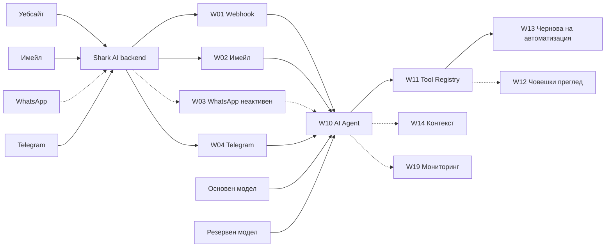

# Shark AI модул 1 в n8n

Модул 1 използва един AI Agent за заявки от уебсайт, имейл и Telegram. W03 WhatsApp е запазен като неактивен вход. W04 Telegram допълва раздели 3.1 и 3.2 на спецификацията. Текущият пакет съдържа локални, неактивни шаблони за n8n. Оригиналният workflow е „Шарк агент — Основен“. Предишното му изпълнение №3038 е проверило началната ръчна верига. [Оригинален workflow](https://imotinadezhda.app.n8n.cloud/workflow/y1RLdFfwaWSdsSGZ) · [Изпълнение №3038](https://imotinadezhda.app.n8n.cloud/workflow/y1RLdFfwaWSdsSGZ/executions/3038)

## Общият чат на сайта

Общият чат, разговорите за стратегии и портфейлът изпращат съобщения към производствения уеб вход на „Шарк агент — Основен“. Сървърът проверява сесията и собствеността на разговора. Агентът получава до три скорошни двойки текстови съобщения. Достъпът му до финансовите и търговските справки зависи от текущите разрешения на собственика. Изрично избраните инструменти за файлове и проекти запазват собствените си разписки.

В оригиналния workflow „Уеб вход“ използва отделна Header Auth връзка със заглавка `X-Shark-Agent-Key`. Въведи същата стойност във Vercel Production като `SHARKAI_N8N_AGENT_KEY`. Разреши възела и публикувай оригиналния workflow с път `POST shark-ai/module-1/webhook`. Ръчната диагностика проверява отговора на аритметичен въпрос и идентификатора на заявката. При недостъпен вход чатът показва грешката и предлага повторно изпращане. Плановете с лимит отчитат текста на заявката и на отговора по `cl100k_base`.

## Архитектура



Пунктираните връзки изискват конфигурация. Backend удостоверява канала и потребителя, проверява текущите права, съгласията и rate limit, и издава `request_id`. Webhook адаптерите очакват само нормализирана server-to-server заявка. Договорите са в `schemas/`.

| Workflow | Роля в локалния пакет |
| --- | --- |
| W01 | Приема удостоверена заявка от Shark AI backend за уеб канала. |
| W02 | Приема нормализирана имейл заявка от backend. Провайдърът и изходящата доставка изискват свързване. |
| W03 | Запазен неактивен WhatsApp вход. Свързването изисква проверка на provider callback, opt-in, шаблон и прозорец за изпращане. |
| W04 | Приема нормализирана Telegram заявка на POST `shark-ai/module-1/telegram` през Header Auth от Shark AI backend. В оригиналния workflow директен Telegram Trigger изисква настройка на бота и проверка на самоличността. |
| W10 | Свързва един AI Agent с модели и фиксиран инструмент към W11. |
| W11 | Проверява allowlist, схемата и scope за поддържаните локални read/draft операции. |
| W12 | Подготвя метаданни за преглед и отказва изпълнение до свързване на хранилище за одобрения и потвърден канал. |
| W13 | Връща чернова на автоматизация за преглед. |
| W14 | Връща празен контекст до свързване на хранилище с проверена собственост и retention. |
| W19 | Редактира автоматични грешки до стандартно събитие. Доставката на аларми и DLQ изисква конфигурация. |

## Четири етапа за свързване и приемане

1. **Входове.** Свери версията на Cloud инстанцията, идентификатора и последния draft на оригиналния workflow. Експортирай копие за възстановяване. Запази ръчния вход за синтетичните случаи. Свържи W01, W02 и при backend маршрут W04 чрез отделни Header Auth credentials след backend проверките. Потвърди одобрените тестови поща и Telegram бот. W03 остава неактивен.
2. **Агент и модели.** Приложи W10 към оригиналния workflow. Съхрани съществуващите входове и свържи каналите към един AI Agent. Замени `BIND_*` с действителните workflow IDs в извикванията и в caller allowlists. Провери наличните модели, поддържаните node версии и credentials в инстанцията. Провери основния модел, после симулирай проблем, за да провериш резервния.
3. **Инструменти и контрол.** Свържи W11 единствено към определените инструменти. Използвай текущи server-side права, преди да се добавят външни данни или действия. Настрой W12, W14 и W19 след потвърждаване на хранилище, одобряващ, политика за данните и получател на аларми. Ограниченията за Wallet и Investments изискват отделните им модули.
4. **Тестове.** Изпълни по една синтетична заявка от уеб, имейл и Telegram, отделно от теста на модела. Провери, че W03 е деактивиран. Запиши ID на всяко Cloud изпълнение и потвърди зелените връзки в редактора. Провери липсваща автентикация, чужд контекст, непознат инструмент, невалиден вход, опит за външно действие, грешка на модел и обработка на дублирани събития.

## Telegram

В оригиналния workflow използвай същия одобрен Telegram credential в Telegram Trigger и Send Message. За личен разговор потребителят първо стартира бота с `/start` или изпраща съобщение. Входящият update дава `message.chat.id` за отговора и `message.from.id` за проверка на подателя. Телефонен номер не замества chat ID. [Telegram credentials](https://docs.n8n.io/integrations/builtin/credentials/telegram/) · [Telegram Bot API](https://core.telegram.org/bots/api#sendmessage) · [Въведение за ботове](https://core.telegram.org/bots)

Провери chat ID и sender ID спрямо разрешена връзка със Shark AI потребител и разговор. Изпрати отговор само до проверения входящ чат. Избери един собственик на webhook за бота, директен n8n вход или backend. Използвай отделен тестов бот, ако производственият вече получава събития. [Telegram Trigger](https://docs.n8n.io/integrations/builtin/trigger-nodes/n8n-nodes-base.telegramtrigger/) · [Тестов и производствен webhook](https://docs.n8n.io/integrations/builtin/trigger-nodes/n8n-nodes-base.telegramtrigger/common-issues/)

## Проверки

```powershell
node --test tests/check-module-1-workflows.cjs
```

Локалният тест проверява JSON графите и логиката без n8n credentials. Поведението в Cloud се приема след изпълнения в самата инстанция. За n8n Error Trigger използвай автоматична грешка в изолиран тестов workflow. За WhatsApp използвай отделно тестово Meta приложение, защото един Meta app има една регистрация на webhook. [n8n настройки](https://docs.n8n.io/build/manage-workflows/configure-workflow-settings/) · [n8n мониторинг](https://docs.n8n.io/build/flow-logic/handle-errors-gracefully/) · [WhatsApp Trigger](https://docs.n8n.io/integrations/builtin/trigger-nodes/n8n-nodes-base.whatsapptrigger/)

## Избор и проверка на доставчици

| Интеграция | Налична поддръжка | Нужно в Shark AI |
| --- | --- | --- |
| n8n Cloud | Webhook, AI Agent, модели, под-workflow-и и Error Trigger. | Версия на инстанцията, редакторски достъп, caller allowlist и credentials. |
| OpenAI | Структурирани изходи и tool calling. Responses поддържа web/file search, Code Interpreter и MCP според избрания възел. | Проверка на наличния модел и credential. Външните инструменти изискват отделно разрешение през W11. |
| Имейл | n8n поддържа входящ IMAP и изходящ SMTP. | Одобрени провайдър и тестова поща, проверка на подписа при webhook доставка, дедупликация и одобрение преди изпращане. |
| WhatsApp | Meta WhatsApp Business Cloud поддържа credentials за вход и изход. | Неактивен резервен вход. Активирането изисква WABA, отделно тестово приложение, opt-in и одобрени шаблони. |
| Telegram | Официалният Bot API поддържа Telegram Trigger и Send Message с един bot credential. | Одобрен бот, удостоверен webhook, връзка между chat ID, sender ID и Shark AI самоличност, дедупликация по update ID. |

[AI Agent](https://docs.n8n.io/integrations/builtin/cluster-nodes/root-nodes/n8n-nodes-langchain.agent/) · [OpenAI Chat Model](https://docs.n8n.io/integrations/builtin/cluster-nodes/sub-nodes/n8n-nodes-langchain.lmchatopenai/) · [OpenAI tools](https://developers.openai.com/api/docs/guides/tools) · [Meta WhatsApp Business Policy](https://whatsappbusiness.com/policy/)

### Възможности на AI възлите

AI Agent с OpenAI Chat Model и Responses поддържа JSON Schema, web search, file search и Code Interpreter. File search изисква vector store. OpenAI action V2 поддържа Responses и MCP, както и операции с изображения и аудио. Тези възможности зависят от версията на възлите, моделите и наличните credentials. Свързвай външните операции чрез фиксирани инструменти с разрешения в W11. [OpenAI Chat Model](https://docs.n8n.io/integrations/builtin/cluster-nodes/sub-nodes/n8n-nodes-langchain.lmchatopenai/) · [OpenAI action node](https://docs.n8n.io/integrations/builtin/app-nodes/n8n-nodes-langchain.openai/) · [OpenAI API инструменти](https://developers.openai.com/api/docs/guides/tools)

Vercel redeploy е след проверката на модулите и потвърждаването на управлявания проект. Реалната търговия и движението на средства изискват предвидените в спецификацията отделни одобрения.
